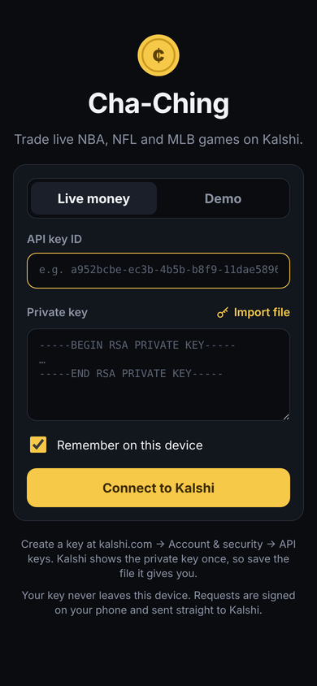
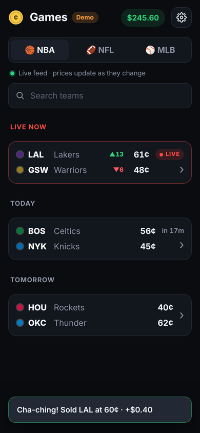
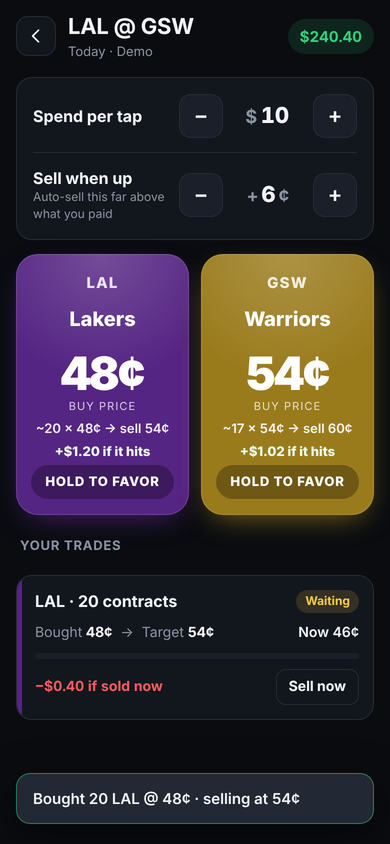

# Cha-Ching

Courtside trading for NBA games on [Kalshi](https://kalshi.com). You're at the game, your team goes on a run, and you hold one button. Cha-Ching buys that team at the current price and immediately lists it for sale at your target.

<p>
  
  
  
</p>

## How it works

1. **Sign in with your Kalshi API key.** Enter the key ID and the private key (paste it or import the `.pem` file). Pick **Live money** or **Demo**.
2. **Pick a game.** Every NBA game open on Kalshi is listed by day. Each team shows its current buy price.
3. **Set your two numbers** at the top of the game screen:
   - **Spend per tap**: how many dollars each tap buys.
   - **Sell when up**: how many cents above your entry price to sell at.
4. **Hold a team's button** for about half a second. A quick tap does nothing, so a pocket press won't trade.
   - The app buys that team's YES contracts at the current ask, with up to 2¢ of slippage (adjustable in Settings) so the order fills in a fast market.
   - Right after the fill, it places a sell order at your actual average entry plus your threshold.
5. **That sell order rests on Kalshi itself.** It fills the moment the price gets there, even if your phone is locked or the app is closed. When the app is open you get a "Cha-ching!" alert and a haptic tap from any screen.

Each trade card shows entry, target, the live bid, a progress bar, and P&L. **Sell now** (tap twice to confirm) cancels the target and sells at the current bid. If a sell order ever fails or gets canceled, the trade is marked **Needs attention** and offers a one-tap retry.

## Runs completely locally

There is no backend. The app signs every request on your device (RSA-PSS or Ed25519, matching Kalshi's API key types) and talks straight to Kalshi's API. Your private key never goes anywhere else.

- **iPhone:** stored in the app's sandboxed storage when **Remember on this device** is checked.
- **Desktop:** encrypted with the OS keychain through Electron `safeStorage`. If no keychain is available, the app tells you and doesn't save the key.

## Quickest way to try it: your computer's browser

Needs **Node.js 22.12 or newer** (check with `node -v`). Older versions are refused at `npm install`.

```bash
git clone https://github.com/AyanJhunjhunwala/cha-ching.git
cd cha-ching
npm install
npm run dev
```

To upgrade Node on a Mac, use one of:

```bash
brew install node@22 && brew link --overwrite --force node@22   # Homebrew
nvm install 22 && nvm use 22                                   # nvm (reads .nvmrc)
conda install -c conda-forge "nodejs>=22.12"                   # if `which node` points into conda
```

Open http://localhost:5173 and sign in with your key; choose **Demo** for a demo key. Vite's dev server forwards requests to Kalshi from your own machine, so nothing goes through anyone else's server.

## Install on your iPhone

> **Why not Electron on iPhone?** Electron only runs on macOS, Windows and Linux, and Apple doesn't allow it on iOS. So the same app is wrapped two ways: **Capacitor** for iPhone (a native iOS app around the web UI) and **Electron** for desktop.

You need a Mac with a current **Xcode** (from the Mac App Store), a free Apple ID, and an iPhone on iOS 15 or later.

```bash
npm install
npm run ios        # builds the app, syncs it into ios/, and opens Xcode
```

In Xcode:

1. Select the **App** target → **Signing & Capabilities** → pick your Team (your Apple ID). If Xcode says the bundle ID is taken, change `com.chaching.app` to something unique.
2. Plug in your iPhone, select it as the run destination, and press **Run**.
3. The first time, on the iPhone go to **Settings → General → VPN & Device Management** and trust your developer certificate. You may also need to turn on **Developer Mode** (Settings → Privacy & Security).

With a free Apple ID the app needs re-installing from Xcode every 7 days. A paid Apple Developer account ($99/yr) removes that limit and lets you distribute through TestFlight.

After changing the web code, run `npm run ios:sync` and press Run again.

## Desktop (Electron)

```bash
npm install
npm run electron       # build and launch
npm run dist:desktop   # package an installer into release/
```

## Development

```bash
npm run dev            # http://localhost:5173, hot reload
npm test               # signer, NBA parsing, trading engine, API client
```

In the browser, Vite proxies `/kalshi/live` and `/kalshi/demo` to Kalshi so CORS doesn't block requests.

## Troubleshooting

**`Cannot find native binding` / `Cannot find module '@rolldown/binding-…'` when running `npm run dev`.** Your Node is older than 22.12. npm quietly skips the build tool's native binary on unsupported Node versions. Upgrade Node (see above), then reinstall from scratch:

```bash
rm -rf node_modules
npm install
npm run dev
```

**`EBADENGINE … Required: {"node":">=22.12.0"}` from `npm install`.** Same cause, caught earlier. Upgrade Node and run `npm install` again.

**`npm audit` warnings.** They come from build tooling (electron-builder, the Capacitor CLI); `npm audit --omit=dev` reports none in the app itself. Don't run `npm audit fix --force`: it downgrades packages and breaks the build.

## Getting a Kalshi API key

On kalshi.com go to **Account & security → API keys → Create key**. Kalshi shows the private key **once**, so save the downloaded file. Try **Demo** first with a key from [demo.kalshi.co](https://demo.kalshi.co); demo and live keys are separate.

## Things to know before trading real money

- **Fees.** Kalshi charges trading fees, so a +1¢ or +2¢ target can lose money after fees. P&L in the app is shown before fees.
- **Partial fills.** If the price jumps while you're holding the button, the buy may fill only partly or not at all. The app lists whatever actually filled and tells you if nothing did.
- **Game over.** If the game ends before your target hits, Kalshi cancels the resting sell and your contracts settle at $1 or $0 like any other position.
- **Latency.** Prices refresh every 2 seconds. People watching on TV are slightly behind the arena, but market makers move fast.
- **No guarantees.** This is a tool, not advice. Start in Demo.

## Project layout

```
src/
  kalshi/
    der.js        PEM/DER parsing (PKCS#1, PKCS#8, Ed25519)
    signer.js     request signing: WebCrypto with a pure-JS fallback
    rsa-pss.js    pure-JS RSA-PSS (fallback when crypto.subtle is unavailable)
    sha256.js
    client.js     Kalshi Trade API v2 calls (V2 orders, fixed-point prices)
    transport.js  CapacitorHttp on iPhone, IPC on Electron, Vite proxy in the browser
    money.js      dollar-string ↔ cents, tick rounding
  nba.js          KXNBAGAME events → two-team games, team colors
  trader.js       favor → buy → rest target → track → sell now
  store.js        settings, saved key, trade history (all local)
  ui/             auth, markets, game screens
electron/         desktop shell (main + preload)
ios/              Xcode project (Capacitor, Swift Package Manager)
test/             node:test suites
```

The API client follows Kalshi's current schema from their official SDK: orders go to `POST /portfolio/events/orders` with `bid`/`ask` sides and fixed-point `"0.5600"` prices, and market data uses the `*_dollars` fields.
